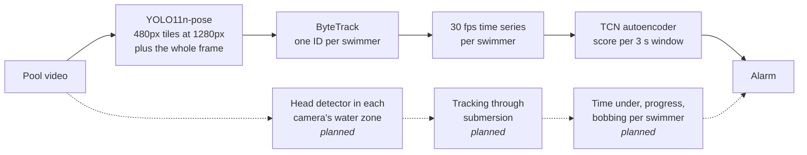

# Hydro-Knight

[](https://github.com/nickpearlstone/Hydro-Knight/actions/workflows/ci.yml)
[](pyproject.toml)
[](LICENSE)
[](https://github.com/astral-sh/uv)
[](https://github.com/astral-sh/ruff)
[](https://github.com/nickpearlstone/Hydro-Knight/commits/main)

Hydro-Knight is a computer vision project that tries to flag swimmers who may be drowning
in pool video. It is built around what I learned as a lifeguard: most drownings are
quiet. A swimmer slips under and doesn't come back up, usually without splashing or
yelling, so a useful detector has to notice when someone disappears. This is a learning
and portfolio project in active development, and nothing has been shown to work yet.

**Current scope (v1):** one wave pool. All 66 rescue clips come from one YouTube series,
so the question is whether drowning can be detected at this pool, with these cameras;
other pools may come later. A result counts only if it beats trivial baselines (box
size, box confidence, missing frames) and holds up when every clip is tested once.

## How it works



The current model is an anomaly detector: it learns normal swimming and scores how far
each swimmer strays from it, since real drowning footage is too rare to train on each
type. The dashed path is the planned redesign around heads in the water, with the
autoencoder kept as a baseline. Both are tuned for recall, since a missed drowning costs
far more than a false alarm.

## Five ways drowning shows up on camera

| Signature | What the camera sees |
|---|---|
| Silent sink | A swimmer goes under mid-pool and never resurfaces |
| Bobbing in place | Repeated up-and-down cycles with no forward movement |
| Passive face-down | A still, face-down body for too long |
| Flailing | Erratic, high-energy arm and leg movement |
| Effort without progress | Swimming hard without moving through the water |

## Findings so far

Details in [docs/FINDINGS.md](docs/FINDINGS.md) and [docs/EVALUATION.md](docs/EVALUATION.md).
Images are pixelated so no one can be recognized.

**1. Resolution and tiling matter more than the model.** YOLO at 1280px found 3 to 6
times more swimmers than at 640px, and tiling raised a crowded frame from about 13 to 50.
Against 736 hand-counted swimmers, the best setup still finds only 30 to 40%.


**2. Evaluation has to follow the victim.** Random scores "caught" every rescue in the
first evaluation, because any flagged swimmer counted. Scoring now uses the victim's own
track from onset to guard contact, next to random and shuffled baselines.

**3. Detection is the bottleneck.** The v2 model ranks victims above other swimmers
(ROC-AUC 0.83, random 0.50) but catches 0 of 25 held-out rescues at 240 false alarms per
hour or fewer. On average the victim is in the tracks for only half of the drowning.

<picture>
  <source media="(prefers-color-scheme: dark)" srcset="docs/images/victim_window_dark.png">
  
</picture>

**4. Watching scores on video catches what numbers miss.** Boxes run from normal (green)
to the alarm line (red). Here the highest score is the lifeguard filming in the
foreground, and the victim has no box.


**5. Synthetic frames can match a real one at the detector level.** At a 0.05 cutoff, a
Blender scene matched to a real frame gives YOLO11n-pose 62 to 64% recall (real: 65%) and
RT-DETRv2 90 to 96% (real: 89%). Whether it helps train a detector is the next test
([log](docs/research/2026-10-19-synthetic-realism-loop.md)).


## Status

**Built:** clip manifest and browser labeler (rescue timelines, victim clicks, swimmer
counts, water zones), two-step pose extraction, per-swimmer features, a TCN autoencoder,
a two-tier evaluation protocol, a pose benchmark, a score-overlay renderer, a Blender
pipeline for labeled synthetic frames, MLflow tracking, and CI.

**Dataset:** 74 clips (66 rescues, 4 normal, 4 unlabeled); 57 rescues extracted and 51
labeled with onset, guard contact, save, and victim positions. Most labels were made by
Claude following a written protocol, and every one was reviewed by hand.

**Next:** trivial baselines and grouped K-fold; a head detector fine-tuned on pool
frames; tracking through submersion with per-swimmer measurements; pretraining on
synthetic frames before fine-tuning on real ones.

## Quickstart

Requires Python 3.11+ and [uv](https://docs.astral.sh/uv/). Or open it in Codespaces and
run `make test` (CPU only):
[](https://codespaces.new/nickpearlstone/Hydro-Knight)

```bash
uv sync                          # install dependencies
uv run python -m pytest          # run the tests
uv run hydroknight --help        # every command, one line each
make hooks                       # optional: run ruff before every commit
```

Pose extraction runs on a Colab or Mac GPU ([docs/COLAB_TRAINING.md](docs/COLAB_TRAINING.md));
synthetic renders need Blender ([synthetic/README.md](synthetic/README.md)).

## Data and privacy

No video is stored here, only source links, metadata, and labels. The footage isn't
licensed for redistribution and shows identifiable people, often children. A clip counts
as a distress event if a lifeguard stepped in. More in [docs/DATA_SOURCING.md](docs/DATA_SOURCING.md).

## Acknowledgements

Built on [Ultralytics YOLO](https://github.com/ultralytics/ultralytics),
[ByteTrack](https://arxiv.org/abs/2110.06864) (Zhang et al., 2022) via Roboflow's
[trackers](https://github.com/roboflow/trackers) and [supervision](https://github.com/roboflow/supervision),
[SAHI](https://arxiv.org/abs/2202.06934) (Akyon et al., 2022),
[RT-DETRv2](https://arxiv.org/abs/2407.17140) (Lv et al., 2024),
[MediaPipe](https://github.com/google-ai-edge/mediapipe), [Blender](https://www.blender.org)
and [MPFB](https://github.com/makehumancommunity/mpfb2) with CC0 MakeHuman assets,
[uv](https://github.com/astral-sh/uv) and [ruff](https://github.com/astral-sh/ruff). Thanks
to the people who post lifeguard rescue footage publicly.

## License

[AGPL-3.0](LICENSE), inherited from [Ultralytics YOLO](https://github.com/ultralytics/ultralytics).
