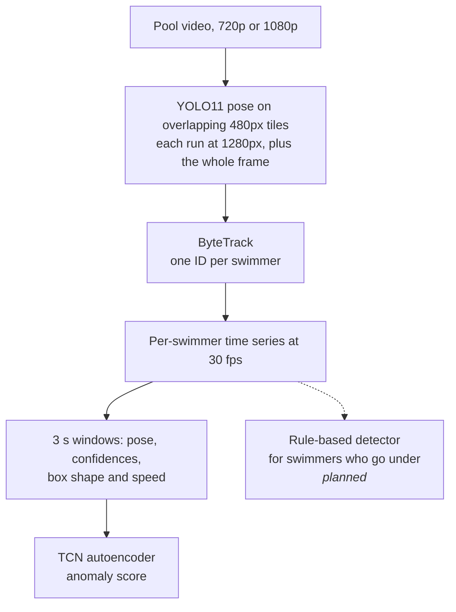

# Hydro-Knight

[](https://github.com/nickpearlstone/Hydro-Knight/actions/workflows/ci.yml)

Hydro-Knight is a computer vision project that watches swimming pool footage and
flags swimmers who may be drowning. It tracks each swimmer, turns their body pose
into a time series, and looks for patterns that match real drowning behavior.

It is built around what I learned as a lifeguard: most drownings are quiet. There
is usually no splashing or yelling. A swimmer slips under and doesn't come back up.
A useful detector has to notice when someone disappears, in addition to spotting
dramatic movement.

This is a learning and portfolio project, still in active development.

## How it works



The model is an **anomaly detector**. It learns what normal swimming looks like and
scores how far a swimmer strays from it. Real drowning footage is rare, so training
a classifier on labeled examples of each type isn't practical. The system is also
tuned to favor recall, because a missed drowning costs far more than a false alarm.

## Five ways drowning shows up on camera

| Signature | What the camera sees | Planned detection |
|---|---|---|
| Silent sink | A swimmer goes under mid-pool and never resurfaces | Per-swimmer timer |
| Bobbing in place | Repeated up-and-down cycles with no forward movement | Per-swimmer rules |
| Passive face-down | A still, face-down body for too long | Pose + duration rules |
| Flailing | Erratic, high-energy arm and leg movement | Autoencoder |
| Effort without progress | Swimming hard without moving through the water | Displacement features |

Only flailing is a good fit for an autoencoder. The other four depend on timing and
position, so they will be handled by explicit rules over each swimmer's track.

## Key findings so far

Full writeups, figures, and numbers are in [docs/FINDINGS.md](docs/FINDINGS.md).

**1. Image resolution mattered more than model choice.** YOLO-pose found far more
swimmers than MediaPipe on crowded scenes. Raising YOLO's input size (the resolution
YOLO runs each image at) from 640px to 1280px found 3 to 6 times more swimmers on
the same frames. A later benchmark against
736 hand-counted swimmers confirmed YOLO11n over larger YOLO11 models, YOLO26, and
MediaPipe, and showed that even the best setup finds only 30 to 40% of swimmers.


*Figures are pixelated on purpose. Pool footage often shows minors, so only the
detected skeletons are drawn clearly.*

**2. Tiling and a dedicated tracker made distant swimmers usable.** Splitting each
frame into overlapping tiles (SAHI) raised detections from about 13 to about 50
swimmers per frame on a crowded clip. ByteTrack then turned those detections into
15 stable swimmer IDs on a short test stretch, down from 53 with a simple tracker.
Over whole clips, tracks are still short (about 1 second median).

**3. The first evaluation couldn't tell a good model from a random one.** The first
trained autoencoder scored a ROC-AUC of 0.539. An audit then showed that a detector
outputting random numbers scored 0.497 and still "caught" every rescue, because a
rescue counted as caught if any of the roughly 21 swimmers in frame was flagged. The
evaluation was rebuilt around the victim's own track, using clicked victim positions
and the moment the lifeguard makes contact, with a random baseline reported next to
every result.

**4. The second model ranks victims above chance but catches none.** On held-out
clips, at 240 false alarms per hour or fewer, the autoencoder caught 0 of 25 rescues,
the same as random scores. It beats random only at thousands of false alarms per hour.
Victim moments do score as more unusual than other swimmers' (ROC-AUC 0.83, random
0.50), but far below any usable alarm threshold. Drawing the scores on the video also
showed that the best-ranked "victim" was the lifeguard filming in the foreground, and
that victims often have no detection box for much of the drowning. The victim matcher
now rejects oversized boxes, and detection results come first in every report.

## Project status

**Built and tested**
- Data pipeline: a JSONL manifest of source clips, a download tool, and a browser
  labeling app with four tabs: each rescue's timeline and where the victim is,
  counting every swimmer on still frames, a quick good / not good review of labels,
  and each camera's coverage zone (the water it can watch well)
- Pose extraction with YOLO11-pose, SAHI tiling, and ByteTrack, in two steps: raw
  detections on the GPU, then merging and tracking offline
- Features: each swimmer resampled to 30 fps, with pose relative to its bounding box,
  all keypoint confidences, a detected flag, and box shape, size, and speed (58 values
  per step). Missed frames stay in as "not detected" instead of being dropped
- A dilated temporal convolutional (TCN) autoencoder in three sizes
- Victim-based scoring on whole held-out clips: catches (an alarm on the victim's own
  track between onset and guard contact) against false alarms per hour, plus victim vs
  other-swimmer ranking, each next to a random baseline
- Saved model weights for every run, and a renderer that draws each swimmer's score on
  the video for review
- An earlier evaluation harness that works with any detector (per-event recall,
  detection delay, false alarms per hour, ROC/PR curves)
- A pose-model benchmark scored against hand-counted swimmers
- MLflow experiment tracking, and CI running pytest plus ruff lint and format checks

**Dataset:** 74 clips (66 rescues, 4 normal, 4 unlabeled). The first version targets
wave pools only: 57 wave-pool rescue clips are extracted with the tiled pipeline, and
51 of them are labeled with drowning onset, guard contact, save, and clicked victim
positions. Most labels were made with an AI-assisted procedure (Claude, following a
fixed written protocol) and every one was reviewed by hand. Five clips whose victim a
review found wrong are left out of training until corrected.

**In progress / next**
1. Finishing the labels: 6 clips are unlabeled and 5 need the victim corrected
2. Scoring victims the tracker keeps losing (tracks under 3 s), and checking whether
   the victim is detected and tracked before going under at these camera distances
3. A rule-based detector for swimmers who go under and don't resurface
4. A head-focused detector, and a distance cutoff so each camera only watches the part
   of the pool it can see clearly

## Quickstart

Requires Python 3.11+ and [uv](https://docs.astral.sh/uv/).

```bash
uv sync                          # install dependencies
uv run python -m pytest          # run the tests
uv sync --extra tracking         # optional: MLflow
uv sync --extra spike            # optional: MediaPipe, to regenerate the comparison figures
```

Pose extraction runs on a Colab GPU or a Mac GPU (see
[docs/COLAB_TRAINING.md](docs/COLAB_TRAINING.md)). The model comparison trains on a Mac
GPU in about an hour:

```bash
uv run python scripts/train_v2.py --sizes small medium large --seeds 0 1 2 --rates capped --device mps
```

## Data and privacy

No video is stored in this repo. It holds a manifest of source links, metadata, and
labels (event times and clicked victim positions). Publicly posted footage isn't licensed for
redistribution, and it shows identifiable people, often children. Labels are based
on outcomes: if a lifeguard stepped in, the clip counts as a distress event. More in
[docs/DATA_SOURCING.md](docs/DATA_SOURCING.md).

## License

[AGPL-3.0](LICENSE), inherited from the pose backend,
[Ultralytics YOLO](https://github.com/ultralytics/ultralytics).
