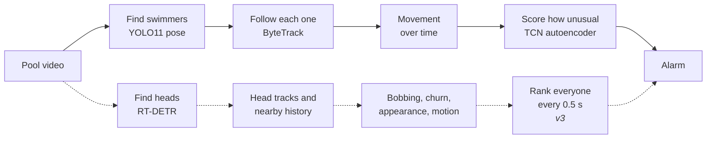
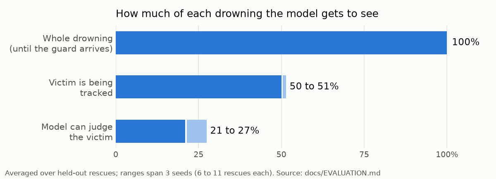
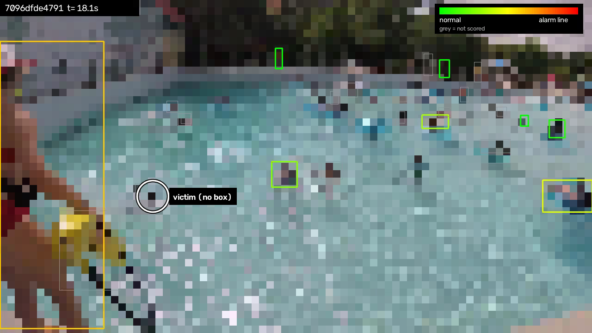
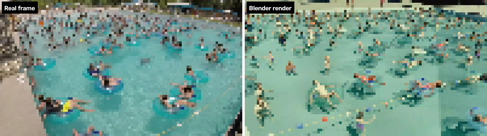

# Hydro-Knight

[](https://github.com/nickpearlstone/Hydro-Knight/actions/workflows/ci.yml)
[](pyproject.toml)
[](LICENSE)
[](https://github.com/astral-sh/uv)
[](https://github.com/astral-sh/ruff)
[](https://github.com/nickpearlstone/Hydro-Knight/commits/main)

Hydro-Knight is a computer vision system that watches pool video and flags swimmers who
may be drowning.

## Why

Most drownings are quiet. A swimmer slips under without splashing or calling for help,
and in a crowded pool it can take too long for anyone to notice. I worked as a lifeguard,
and this project tries to give a camera the same job: notice when someone stops swimming
normally or disappears.

The first version covers one wave pool, using 66 real rescues from one YouTube series of
lifeguard rescues. Other pools may come later. This is a learning and portfolio project,
and nothing has yet been shown to catch a drowning at a usable alarm rate. The sections
below say where it stands and why.

## How it works



Each swimmer is found, given an ID, and followed over time. A model trained only on
normal swimming scores how unusual each one looks, and a high score raises an alarm. The
dashed path is v3, built around heads in the water: it ranks everyone in the pool at
each moment by how much they look and move like a drowning swimmer. Both are tuned to
miss as few drownings as possible, since a missed drowning costs far more than a false
alarm.

## Five ways drowning shows up on camera

| Signature | What the camera sees |
|---|---|
| Silent sink | A swimmer goes under mid-pool and never resurfaces |
| Bobbing in place | Repeated up-and-down cycles with no forward movement |
| Passive face-down | A still, face-down body for too long |
| Flailing | Erratic, high-energy arm and leg movement |
| Effort without progress | Swimming hard without moving through the water |

## What I've learned so far

Images are pixelated so no one can be recognized. Full numbers and methods are in
[docs/FINDINGS.md](docs/FINDINGS.md) and [docs/EVALUATION.md](docs/EVALUATION.md).

**1. Small, distant swimmers are the hardest part.** Running the detector at a higher
resolution, on overlapping pieces of each frame, found several times more swimmers. Even
so, it finds only about a third of the people in a crowded wave pool.


**2. Measuring progress fairly took real work.** The first test gave credit whenever any
swimmer on screen was flagged during a rescue. With about 20 people in view, random
guessing looked perfect. Now a rescue only counts as caught if the alarm is on the person
who was actually drowning, and every result is compared with random guessing.

**3. The model rarely sees the victim.** It does rate victims as more unusual than other
swimmers, but it catches none of 25 test rescues at an alarm rate a lifeguard could work
with. On average, it can only judge the victim during about a quarter of each drowning.

<picture>
  <source media="(prefers-color-scheme: dark)" srcset="docs/images/victim_window_dark.png">
  
</picture>

**4. Watching the output on video catches what numbers miss.** Each box is a swimmer,
colored from normal (green) to alarm (red). In this rescue, the most unusual-looking
"swimmer" is the lifeguard filming in the foreground, and the real victim (circled) is
not detected at all.



**5. Rendered pools can stand in for real ones.** A Blender scene matched to a real
camera gets almost the same detection rates as the real frame, so labeled training images
could be generated by the thousand. Whether they actually improve a detector is the next
test.



## Where it stands

The project has 66 real rescue clips, 51 of them fully labeled with when the drowning
starts, when the lifeguard reaches the victim, and where the victim is (most labeled with
Claude's help and checked by hand). It also has a pipeline that turns video into
per-swimmer tracks, a first anomaly model, an evaluation that scores the actual victim,
and a Blender pipeline for synthetic training images.

A newer design, v3, is built around heads in the water: a head detector trained on pool
footage, head tracks, simple per-head measurements such as bobbing and churning in place,
and a ranker that orders everyone in the pool every half second. It ranks the victim first
for about a third of each drowning and in the top 3 for nearly half, against 2% and 7% by
chance. False-alarm rates can't be measured yet, because there is no normal pool footage
to set an alarm threshold on. Before any result counts, it also has to beat simple
shortcuts, such as flagging whoever is hardest to see. Details are in
[docs/FINDINGS.md section 6](docs/FINDINGS.md#6-third-model-v3-head-anchored-stack).

## Getting started

Requires Python 3.11+ and [uv](https://docs.astral.sh/uv/).

```bash
uv sync                      # install dependencies
uv run python -m pytest      # run the tests
uv run hydroknight --help    # list every command
make hooks                   # lint and scan for leaked keys on every commit (brew install gitleaks)
```

To try it without installing anything, open it in Codespaces and run `make test`:

[](https://codespaces.new/nickpearlstone/Hydro-Knight)

Pose extraction needs a GPU ([docs/COLAB_TRAINING.md](docs/COLAB_TRAINING.md)), and
synthetic renders need Blender ([synthetic/README.md](synthetic/README.md)).

## Data and privacy

No video is stored in this repository, only links to public videos, metadata, and
labels. The footage shows identifiable people, often children, so every image here is
pixelated. Details are in [docs/DATA_SOURCING.md](docs/DATA_SOURCING.md).

## Acknowledgements

Built with [Ultralytics YOLO](https://github.com/ultralytics/ultralytics),
[ByteTrack](https://arxiv.org/abs/2110.06864), [SAHI](https://arxiv.org/abs/2202.06934),
[RT-DETRv2](https://arxiv.org/abs/2407.17140),
[MediaPipe](https://github.com/google-ai-edge/mediapipe), and [Blender](https://www.blender.org)
with [MPFB](https://github.com/makehumancommunity/mpfb2) assets. Thanks to the people who
share lifeguard rescue footage publicly.

## License

[AGPL-3.0](LICENSE), inherited from [Ultralytics YOLO](https://github.com/ultralytics/ultralytics).
