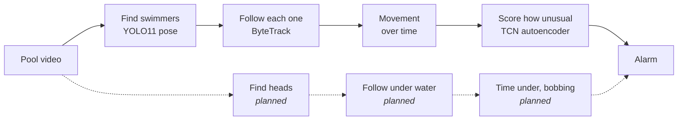

# Hydro-Knight

[](https://github.com/nickpearlstone/Hydro-Knight/actions/workflows/ci.yml)
[](pyproject.toml)
[](LICENSE)
[](https://github.com/astral-sh/uv)
[](https://github.com/astral-sh/ruff)
[](https://github.com/nickpearlstone/Hydro-Knight/commits/main)

Hydro-Knight is a computer vision system that watches pool video and flags swimmers who
may be drowning.

Hydro-Knight is a computer vision project that tries to flag swimmers who may be
drowning in pool video. Version 1 is a single-venue feasibility study: every rescue
clip comes from one wave pool, from one YouTube series of real lifeguard rescues. The
question it asks is narrow: can drowning be detected from video at this pool, with
these cameras? Nothing has been shown to work yet.

The system tracks each swimmer, turns what the camera sees of them into a time series,
and looks for patterns that match real drowning behavior.
## Why

Most drownings are quiet. A swimmer slips under without splashing or calling for help,
and in a crowded pool it can take too long for anyone to notice. I worked as a lifeguard,
and this project tries to give a camera the same job: notice when someone stops swimming
normally or disappears.

The first version covers one wave pool, using 66 real rescues from one YouTube series of
lifeguard rescues. Other pools may come later. This is a learning and portfolio project,
and nothing has been shown to work yet. The sections below say where it stands and why.

## Scope

**In scope for v1:** one wave pool. The claim to test is only "learnable at this
pool", so a split that keeps whole clips apart (train on some rescues, test on others)
is an acceptable test of it. Generalization to other pools is out of scope.

**What the proof of concept has to show:**
- **It beats trivial baselines, not just random scores.** Victims are mostly near
  inner tubes and are often small, and box size, box confidence and a detected flag
  are model inputs, so a model could score well from shortcuts. It counts only if it
  beats simple scores on the same protocol: the share of missing frames, the number of
  times a swimmer flips between detected and missing, 1 minus the mean box confidence,
  and negative box height, plus the same model with all pose coordinates removed.
- **It holds up when every labeled clip is tested once** (grouped K-fold), instead of
  three random splits. With 6 to 11 test clips per split, the victim-separation AUC
  (FINDINGS section 5) moves from 0.74 to 0.93 on the split alone.
- **It can see the victim.** Today the victim is in the input tracks for only about
  half of the distress window, and the model scores the victim for only 21 to 27% of
  it. Both detection and the scoring of short tracks have to improve before more model
  work can show anything.

**Allowed at a single site:** shortcuts that only make sense at one pool, such as
hand-drawn water zones, homographies to the water surface, and thresholds tuned to
this site. Camera position changes from video to video, so zones and homographies are
set per clip.

**Limitations:** most events involve inner tubes and many victims are young children,
so v1 covers that kind of rescue more than a silent submersion. Every event was caught
by a lifeguard, which biases the data toward drownings that a guard can see. This is
also a hard setting: an oblique camera above the water of a crowded wave pool.
Commercial systems mostly watch from underwater, where a still body near the bottom
is easy to see.

## How it works



Each swimmer is found, given an ID, and followed over time. A model trained only on
normal swimming scores how unusual each one looks, and a high score raises an alarm. The
dashed path is the planned redesign, built around heads in the water. Both are tuned to
miss as few drownings as possible, since a missed drowning costs far more than a false
alarm.

## Five ways drowning shows up on camera

| Signature | What the camera sees | Planned detection |
|---|---|---|
| Silent sink | A swimmer goes under mid-pool and never resurfaces | Per-swimmer timer |
| Bobbing in place | Repeated up-and-down cycles with no forward movement | Per-swimmer rules |
| Passive face-down | A still, face-down body for too long | Pose + duration rules |
| Flailing | Erratic, high-energy arm and leg movement | Autoencoder |
| Effort without progress | Swimming hard without moving through the water | Displacement features |

Only flailing is a good fit for an autoencoder. The other four depend on timing and
position, so they will be handled by explicit rules over each swimmer's track.

## Key findings so far

Full writeups, figures, and numbers are in [docs/FINDINGS.md](docs/FINDINGS.md).

**1. Image resolution mattered more than model choice.** YOLO-pose found far more
swimmers than MediaPipe on crowded scenes. Raising YOLO's input size (the resolution
YOLO runs each image at) from 640px to 1280px found 3 to 6 times more swimmers on
the same frames. A later benchmark against
736 hand-counted swimmers confirmed YOLO11n over larger YOLO11 models, YOLO26, and
MediaPipe, and showed that even the best setup finds only 30 to 40% of swimmers.


*Figures are pixelated on purpose. Pool footage often shows minors, so only the
detected skeletons are drawn clearly.*

**2. Tiling and a dedicated tracker made distant swimmers usable.** Splitting each
frame into overlapping tiles (SAHI) raised detections from about 13 to about 50
swimmers per frame on a crowded clip. ByteTrack then turned those detections into
15 stable swimmer IDs on a short test stretch, down from 53 with a simple tracker.
Over whole clips, tracks are still short (about 1 second median).

**3. The first evaluation couldn't tell a good model from a random one.** The first
trained autoencoder scored a ROC-AUC of 0.539. An audit then showed that a detector
outputting random numbers scored 0.497 and still "caught" every rescue, because a
rescue counted as caught if any of the roughly 21 swimmers in frame was flagged. The
evaluation was rebuilt around the victim's own track, using clicked victim positions
and the moment the lifeguard makes contact, with a random baseline reported next to
every result.

**4. The second model ranks victims above chance but catches none.** On held-out
clips, at 240 false alarms per hour or fewer, the autoencoder caught 0 of 25 rescues,
the same as random scores. It beats random only at thousands of false alarms per hour.
Victim moments do score as more unusual than other swimmers' (ROC-AUC 0.83, random
0.50), but far below any usable alarm threshold. Drawing the scores on the video also
showed that the best-ranked "victim" was the lifeguard filming in the foreground, and
that victims often have no detection box for much of the drowning. The victim matcher
now rejects oversized boxes, and detection results come first in every report.

## Project status

**Built and tested**
- Data pipeline: a JSONL manifest of source clips, a download tool, and a browser
  labeling app with four tabs: each rescue's timeline and where the victim is,
  counting every swimmer on still frames, a quick good / not good review of labels,
  and each camera's coverage zone (the water it can watch well)
- Pose extraction with YOLO11-pose, SAHI tiling, and ByteTrack, in two steps: raw
  detections on the GPU, then merging and tracking offline
- Features: each swimmer resampled to 30 fps, with pose relative to its bounding box,
  all keypoint confidences, a detected flag, and box shape, size, and speed (58 values
  per step). Missed frames stay in as "not detected" instead of being dropped
- A dilated temporal convolutional (TCN) autoencoder in three sizes
- Victim-based scoring on whole held-out clips: catches (an alarm on the victim's own
  track between onset and guard contact) against false alarms per hour, plus victim vs
  other-swimmer ranking, each next to a random baseline
- Saved model weights for every run, and a renderer that draws each swimmer's score on
  the video for review
- An earlier evaluation harness that works with any detector (per-event recall,
  detection delay, false alarms per hour, ROC/PR curves)
- A pose-model benchmark scored against hand-counted swimmers
- MLflow experiment tracking, and CI running pytest plus ruff lint and format checks

**Dataset:** 74 clips (66 rescues, 4 normal, 4 unlabeled). All 66 rescues come from
one wave pool, from one YouTube series. The first version targets that pool only: 57
rescue clips are extracted with the tiled pipeline, and 51 of them are labeled with
drowning onset, guard contact, save, and clicked victim positions. Most labels were
made with an AI-assisted procedure (Claude, following a fixed written protocol) and
every one was reviewed by hand. Five clips whose victim a review found wrong are left
out of training until corrected.

**In progress / next**
1. Finishing the labels: 6 clips are unlabeled and 5 need the victim corrected
2. Scoring victims the tracker keeps losing (tracks under 3 s), and checking whether
   the victim is detected and tracked before going under at these camera distances
3. A rule-based detector for swimmers who go under and don't resurface
4. A head-focused detector, and a distance cutoff so each camera only watches the part
   of the pool it can see clearly

## Quickstart
| Signature | What the camera sees |
|---|---|
| Silent sink | A swimmer goes under mid-pool and never resurfaces |
| Bobbing in place | Repeated up-and-down cycles with no forward movement |
| Passive face-down | A still, face-down body for too long |
| Flailing | Erratic, high-energy arm and leg movement |
| Effort without progress | Swimming hard without moving through the water |

## What I've learned so far

Images are pixelated so no one can be recognized. Full numbers and methods are in
[docs/FINDINGS.md](docs/FINDINGS.md) and [docs/EVALUATION.md](docs/EVALUATION.md).

**1. Small, distant swimmers are the hardest part.** Running the detector at a higher
resolution, on overlapping pieces of each frame, found several times more swimmers. Even
so, it finds only about a third of the people in a crowded wave pool.


**2. Measuring progress fairly took real work.** The first test gave credit whenever any
swimmer on screen was flagged during a rescue. With about 20 people in view, random
guessing looked perfect. Now a rescue only counts as caught if the alarm is on the person
who was actually drowning, and every result is compared with random guessing.

**3. The model rarely sees the victim.** It does rate victims as more unusual than other
swimmers, but it catches none of 25 test rescues at an alarm rate a lifeguard could work
with. On average, it can only judge the victim during about a quarter of each drowning.

<picture>
  <source media="(prefers-color-scheme: dark)" srcset="docs/images/victim_window_dark.png">
  
</picture>

**4. Watching the output on video catches what numbers miss.** Each box is a swimmer,
colored from normal (green) to alarm (red). In this rescue, the most unusual-looking
"swimmer" is the lifeguard filming in the foreground, and the real victim (circled) is
not detected at all.


**5. Rendered pools can stand in for real ones.** A Blender scene matched to a real
camera gets almost the same detection rates as the real frame, so labeled training images
could be generated by the thousand. Whether they actually improve a detector is the next
test.


## Where it stands

The project has 66 real rescue clips, 51 of them fully labeled with when the drowning
starts, when the lifeguard reaches the victim, and where the victim is (most labeled with
Claude's help and checked by hand). It also has a pipeline that turns video into
per-swimmer tracks, a first anomaly model, an evaluation that scores the actual victim,
and a Blender pipeline for synthetic training images.

The next goal is to keep the victim in view for most of a drowning: a head detector
trained on pool footage, tracking that holds on to a swimmer under water, and simple
measurements such as time under water and forward progress. Before any result counts, it
has to beat simple shortcuts, such as flagging whoever is hardest to see.

## Getting started

Requires Python 3.11+ and [uv](https://docs.astral.sh/uv/).

```bash
uv sync                      # install dependencies
uv run python -m pytest      # run the tests
uv run hydroknight --help    # list every command
```

To try it without installing anything, open it in Codespaces and run `make test`:

[](https://codespaces.new/nickpearlstone/Hydro-Knight)

Pose extraction needs a GPU ([docs/COLAB_TRAINING.md](docs/COLAB_TRAINING.md)), and
synthetic renders need Blender ([synthetic/README.md](synthetic/README.md)).

## Data and privacy

No video is stored in this repository, only links to public videos, metadata, and
labels. The footage shows identifiable people, often children, so every image here is
pixelated. Details are in [docs/DATA_SOURCING.md](docs/DATA_SOURCING.md).

## Acknowledgements

Built with [Ultralytics YOLO](https://github.com/ultralytics/ultralytics),
[ByteTrack](https://arxiv.org/abs/2110.06864), [SAHI](https://arxiv.org/abs/2202.06934),
[RT-DETRv2](https://arxiv.org/abs/2407.17140),
[MediaPipe](https://github.com/google-ai-edge/mediapipe), and [Blender](https://www.blender.org)
with [MPFB](https://github.com/makehumancommunity/mpfb2) assets. Thanks to the people who
share lifeguard rescue footage publicly.

## License

[AGPL-3.0](LICENSE), inherited from [Ultralytics YOLO](https://github.com/ultralytics/ultralytics).
